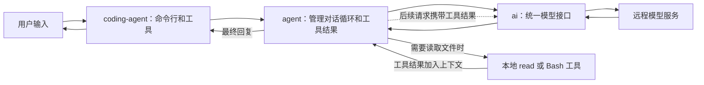

# 实践课 4：Pi Agent 的模型调用与运行流程

## 一、实验目的

在 Pi 项目的 Agent 循环中加入两条日志，重新构建后，通过直接问答和读取文件两种会话，观察模型调用与工具结果进入上下文的过程。

本次实验使用的项目目录是 `F:\2026autumn\开源软件\实验课\PiAgent\pi-hunnu-2026`。两个会话的模型均为 `deepseek-flash`。

## 二、源码修改

打开 `packages/agent/src/agent-loop.ts`，在模型调用前加入日志：

```typescript
console.error("[P4] Agent 即将请求模型"); // 新增
const response = await streamFunction(config.model, llmContext, {
    // 后续参数保持原有代码
```

这条日志位于 `await streamFunction(...)` 前面，用来记录 Agent 执行到模型调用位置。


**图 1　在模型调用前添加日志**

接着，在工具结果写入上下文后加入另一条日志：

```typescript
for (const result of toolResults) {
    currentContext.messages.push(result);
    console.error("[P4] 工具结果已加入上下文"); // 新增
    newMessages.push(result);
}
```

这条日志位于 `for` 循环内。每写入一条工具结果，就会打印一次。当前本地源码中，两条日志分别位于第 412 行和第 285 行


**图 2　在工具结果加入上下文后添加日志**

## 三、重新构建与启动

在项目根目录执行：

```powershell
npm run build
```

截图中显示了构建命令，以及 `coding-agent` 的编译、资源复制和打包输出。末尾显示 `Built packages\coding-agent\dist\bundle`，共 84 个文件，随后终端回到命令提示符。期间还出现 `min-release-age-exclude` 配置警告。


**图 3　重新构建的输出**


实验要求使用编译产物启动 Pi：

```powershell
node .\packages\coding-agent\dist\cli.js
```

现有截图展示了 Pi 交互界面和项目工作目录：


**图 4　Pi 交互界面**


## 四、两次会话的观察

### 4.1 会话 A：直接问答

输入：

```text
请直接用一句话解释什么是 Git 分支。
```

Pi 回答 Git 分支是指向某次提交的可移动指针，可以从同一个仓库分出独立的提交历史。截图中没有出现工具调用记录，显示了 1 条模型请求日志：

```text
[P4] Agent 即将请求模型
```


**图 5　直接问答的结果**

从截图中可见的信息看，这次直接问答出现了 1 条请求模型日志，没有看到工具结果日志，也没有看到工具调用。终端中的日志与交互界面混排，截图上日志显示在回复下方；结合源码位置，它记录的是程序执行到模型调用前的位置。

### 4.2 会话 B：读取文件

项目根目录中的 `practice4.txt` 内容为：

```text
copy_understand
```

本次实验要求 Pi 用 `read` 工具读取该文件并回答实验代号。截图显示 Pi 使用 Bash 命令检查文件，命令包括 `cat -A practice4.txt`，输出了 `copy_understand`；最终回复的实验代号也是 `copy_understand`。


**图 6　文件内容、工具输出和最终回复**


### 4.3 对比与理解

| 项目 | 会话 A：直接问答 | 会话 B：读取文件 |
| --- | --- | --- |
| 任务 | 解释 Git 分支 | 读取文件中的实验代号 |
| 截图中可见的工具 | 没有看到工具调用 | Bash 命令读取并检查了文件；`read` 调用未截到 |
| 可见的 `[P4]` 日志 | 1 条“Agent 即将请求模型” | 截图中未显示，无法统计 |
| 结果 | 返回 Git 分支的解释 | 返回 `copy_understand` |
| 可确认的请求次数 | 截图显示 1 条请求日志 | 现有截图不足以确定 |

会话 A 中，截图展示了模型直接给出回答。会话 B 中，截图明确显示了 Bash 工具对本地文件的读取；模型回复中提到的 `read` 调用还需要通过工具记录核对。实际读文件的是由 Pi 执行的本地工具，模型提出工具调用并根据返回的结果生成回答。

源码中，`currentContext.messages.push(result)` 将工具结果加入当前上下文。之后如果 Agent 再发起模型请求，下一轮的上下文会包含此前的对话、模型提出的工具调用以及相应工具结果，模型就可以根据文件内容回答。

如果一次会话只调用一次工具，工具返回后模型直接回答，按代码位置可能观察到下面的顺序

```text
[P4] Agent 即将请求模型
[P4] 工具结果已加入上下文
[P4] Agent 即将请求模型
```


## 五、模块运行流程图

下面的图根据代码职责整理，箭头表示请求或结果在各部分之间的传递方向，虚线表示工具结果进入后续模型请求的过程。



`coding-agent` 提供命令行界面和本地工具；`agent` 组织模型请求、工具调用和上下文；`ai` 封装模型接口；远程模型服务根据收到的上下文返回响应。文件读取发生在本地工具中，读取结果再交回 Agent 循环。

